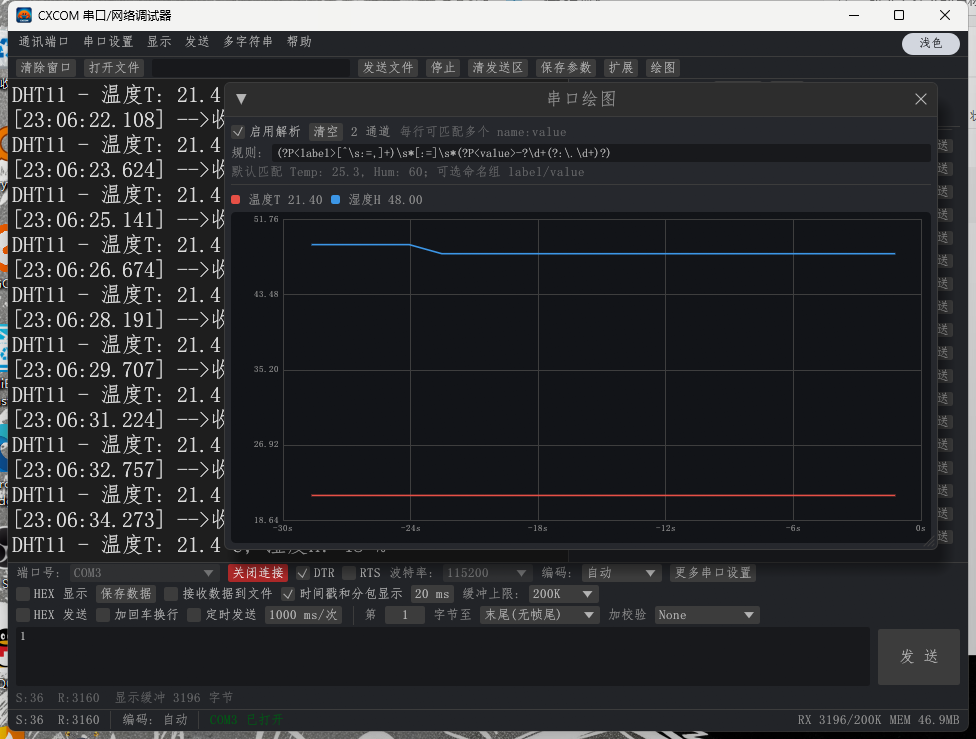

# CXCOM

> 版本说明：当前为 **v001**（第一个初始版本）。

Rust + **egui** + **OpenGL (glow)** 实现的串口 / 网络调试器，支持 GB2312 与 UTF-8 收发、串口绘图、AT 指令预设和浅色/深色主题。

[](https://www.rust-lang.org/)
[](https://github.com/emilk/egui)
[](https://github.com/grovesNL/glow)
[](https://creativecommons.org/licenses/by-nc-nd/4.0/)



## 功能

- **串口 / TCP Client / TCP Server / UDP** 四种通讯方式
- **GB2312 / UTF-8 / 自动识别** 收发，同一编码同时用于接收和发送
- 流式解码：中文被拆到多次串口读取时不会乱码
- 接收区增量追加、尾部跟随；上滚暂停跟随，可一键回到底部
- 收发同窗显示：`-->收<--` / `<--发-->`，均带毫秒时间戳
- 字符级拖选，`Ctrl+C` 复制选中文字，右键复制全部 / 清空
- HEX 显示与 HEX 发送、CRC16 / ADD / XOR 校验
- 定时发送、文件发送、接收数据写文件
- 99 条快捷字符串，内置 ESP-01S / ESP8266 AT 指令预设
- **串口绘图**：正则提取 `name:value`，实时曲线、自动缩放
- 系统字体枚举（默认宋体），浅色/深色主题一键切换
- 串口 / TCP 故障自动重连
- 保存数据按当前显示导出 UTF-8 `.log`

## 编码

| 模式 | 说明 |
|---|---|
| GB2312 | GBK / CP936 超集，兼容常见中文串口设备 |
| UTF-8 | 标准 UTF-8，支持跨读取拆分字符 |
| 自动 | 优先按合法 UTF-8 解码，失败段回退 GBK；可混合显示 |

收发使用同一模式。接收解码器保留不完整字节，等下一包数据到达后继续拼接，不会把中文拆坏。

## 串口绘图

工具栏 **“绘图”** 打开绘图窗口。默认规则：

```regex
(?P<label>[^\s:=,]+)\s*[:=]\s*(?P<value>-?\d+(?:\.\d+)?)
```

兼容：

```text
Temp: 25.3, Hum: 60
温度T: 18.6 C, 湿度H: 54 %
DHT11 - 温度T: 22.4 C, 湿度H: 67 %
```

- 每行可匹配多个通道。
- 自定义规则可使用命名组 `label` / `value`；没有命名组时，第 1 组作通道名，最后一个数字捕获作值。
- 显示最近 30 秒，Y 轴自动缩放，最多 24 通道、每通道 3000 点。
- 数据只保留最近 35 秒；通道长时间无数据会自动回收，容量也会收缩。
- **关闭绘图窗口立即释放全部曲线缓存**，窗口未打开时不解析绘图数据。
- 规则错误会显示在窗口内，“清空”只清绘图数据。

## ESP-01S AT 预设

“扩展”面板或菜单 **多字符串 → 载入 ESP-01S AT 指令** 可载入：

- 基础：`AT`、`AT+RST`、`AT+GMR`、`AT+RESTORE`、`AT+UART_DEF`
- WiFi：`AT+CWMODE`、`AT+CWLAP`、`AT+CWJAP`、`AT+CWQAP`、`AT+CIFSR`
- TCP/UDP：`AT+CIPMUX`、`AT+CIPSTART`、`AT+CIPSEND`、`AT+CIPCLOSE`
- 透传：`AT+CIPMODE=1`、`AT+CIPSEND`、`+++`
- 其他：`AT+PING`、`AT+SLEEP=0`

字符串中的 `\r\n` 会转换成真正的 CRLF；`+++` 不带换行。

## 自动重连

串口写入/读取失败（例如 `os error 121`）或 TCP 断线时：

1. 关闭故障连接；
2. 状态栏提示“自动修复中”；
3. 每秒重试；
4. 恢复后自动继续接收和发送。

可在“串口设置”中关闭。等待期间收到的待发送数据会暂存，重连后补发。

## 主题

右上角胶囊按钮切换 **浅色 / 深色**，选择自动保存到 `CXCOM.ini` 的 `dark=0/1`。深色模式会同步调整菜单、控件、接收区和绘图背景。

## 构建

需要 Rust stable。Windows / Linux / macOS 使用同一套源码。

```bash
cargo build --release
```

产物：

```text
target/release/CXCOM.exe      # Windows
target/release/CXCOM          # Linux / macOS
```

Windows exe 图标使用 `icon/app.res` 预生成资源，**构建不需要 Windows SDK / rc.exe**。Linux 需要常见 winit/OpenGL 开发包，例如 Debian/Ubuntu：

```bash
sudo apt install libxkbcommon-dev libwayland-dev libx11-dev libxrandr-dev libxi-dev libgl1-mesa-dev
```

### 跨平台说明

| 平台 | 字体 | GB2312 | 文件对话框 |
|---|---|---|---|
| Windows | 系统字体目录 + 用户字体 | Win32 `MultiByteToWideChar(936)` | 原生对话框 |
| macOS | `/System/Library/Fonts`、`/Library/Fonts`、`~/Library/Fonts` | `encoding_rs` GBK | 保存到当前目录 |
| Linux | `/usr/share/fonts`、`~/.local/share/fonts`、`~/.fonts` | `encoding_rs` GBK | 保存到当前目录 |

启动时扫描系统字体，通过 `cmap` 检测 `U+4E2D`，只列出能显示中文的字体；Windows 默认宋体，macOS 优先 PingFang SC，Linux 优先 Noto Sans CJK / 文泉驿。

## 使用

1. 选择串口或 TCP/UDP，设置参数后点击“打开连接”。
2. 选择编码（GB2312 / UTF-8 / 自动）。
3. 接收区显示数据；需要看曲线时点“绘图”。
4. 输入内容后点“发送”，`Ctrl+Enter` 也可发送。
5. 需要批量指令时打开“扩展”，可载入 AT 预设或自行编辑。
6. “保存数据”按当前屏幕显示导出 `.log`（时间戳、HEX 格式与界面一致）。

参数保存在 exe 同目录的 `CXCOM.ini`。

## 体积与内存

本机 release 实测：

| 项目 | 数值 |
|---|---|
| exe | **约 3.19 MB**（含 regex 引擎与图标资源） |
| 私有工作集 | **约 45 MB** |
| 接收缓冲 | 200 KB – 20 MB 可调 |
| 渲染上限 | 只把末尾 256 KB 转成显示行 |

OpenGL 驱动/上下文占进程工作集的一大部分，属于渲染后端成本。

## 目录

```text
CXCOM/
├─ src/
│  ├─ app.rs        界面、绘图、主题与交互
│  ├─ text.rs       GB2312 / UTF-8 / 自动 流式编解码
│  ├─ buffer.rs     有界接收缓冲与行渲染
│  ├─ transport.rs  串口 / TCP / UDP 工作线程与重连
│  ├─ checksum.rs   HEX 解析与 CRC/ADD/XOR
│  ├─ config.rs     CXCOM.ini 与 AT 预设
│  ├─ fonts.rs      系统字体枚举与加载
│  └─ win.rs        Win32 文件对话框、GBK、内存统计
├─ assets/          字体兜底
├─ icon/            tu.png / tu.ico / app.rc / app.res
├─ docs/            截图
├─ tools/           字体生成脚本
├─ build.rs         链接预生成图标资源
└─ Cargo.toml
```

## 已知边界

- 未实现原工具的 ISP 烧写（STC / STM32）。
- `serialport` crate 不支持 1.5 停止位与 Mark/Space 校验，当前提供 1/2 停止位与 None/Odd/Even。
- macOS / Linux 未内置原生文件对话框，保存文件会写入当前目录；可在 Windows 使用完整对话框体验。

## License

[](https://creativecommons.org/licenses/by-nc-nd/4.0/)

本项目采用 **Creative Commons Attribution-NonCommercial-NoDerivatives 4.0 International（CC BY-NC-ND 4.0）**：

- **署名**：分享时需注明来源 CXCOM 并附许可证链接。
- **非商业**：不得用于商业目的。
- **禁止演绎**：不得分享修改后的衍生版本。

完整法律文本见 [LICENSE](LICENSE)，或访问
<https://creativecommons.org/licenses/by-nc-nd/4.0/>。

如需商业授权或定制，欢迎加入 QQ 群 **947963288**（Rust 嵌入式探讨）。
